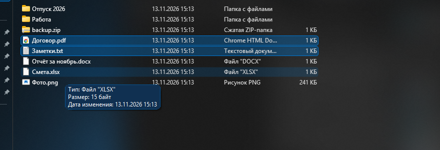
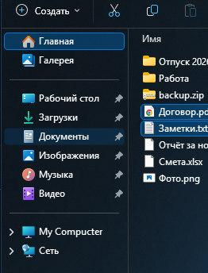

# Explorer Selection Styler

A [Windhawk](https://windhawk.net/) mod that recolors the selection, the hover
highlight, the navigation pane, the column headers and the tooltips of Windows
11 File Explorer.

File Explorer draws the keyboard focus with a thin, opaque grey rectangle and
the hover/selection highlights with flat grey fills. None of that can be
recolored through Windows settings.

This mod replaces those theme parts with its own painting: a translucent fill
and a rounded border of any color for the selected item, a softer fill for the
hovered one, plus matching colors for the navigation pane, the column headers
and the tooltips. Everything is drawn with rounded corners and scales with the
monitor DPI.

## What it changes

- **File list** - selection fill + border, hover fill, no stock grey left behind
- **Navigation pane** - hover and selection of the tree items
- **Column headers** ("Name", "Date modified", ...) - hover and pressed states
- **Tooltips** - background, border and rounded window corners
- **Details pane header** and the other themed item rows are left untouched

## Screenshots

The file list: two selected items with a rounded border, another one hovered.

The navigation pane uses the same palette as the file list.

Hovering a column header paints it with the hover fill instead of the stock
grey rectangle.

Tooltips are recolored and get rounded corners.

## Installation

1. Install [Windhawk](https://windhawk.net/) 1.7 or newer.
2. Open Windhawk, go to **Mods** -> **Create new mod**.
3. Replace the template with the contents of
   [`explorer-selection-border.wh.cpp`](explorer-selection-border.wh.cpp).
4. Press **Compile mod** (Ctrl+B), then **Install mod**.

Alternatively, save the `.wh.cpp` file to disk and use **Install from file** in
the same menu.

## Settings

### Selection

| Setting | Default | Description |
| --- | --- | --- |
| Border color | `#0078D4` | Hex RGB color of the selection border |
| Border opacity | `100` | `0` (invisible) to `100` (solid) |
| Border thickness | `1` | Border width in pixels, 1 to 6 |
| Corner radius | `4` | Pixels, `0` for sharp corners |
| Border inset | `1` | Distance in pixels between the item edge and the border |

### Fill

| Setting | Default | Description |
| --- | --- | --- |
| Fill color | `#0078D4` | Hex RGB color of the selection and hover fill |
| Selection fill opacity | `35` | `0` (transparent) to `100` (solid) |
| Hover fill opacity | `18` | Fill opacity for the item under the mouse pointer |

### Tooltips

| Setting | Default | Description |
| --- | --- | --- |
| Restyle tooltips | `on` | Repaint Explorer tooltips and round their corners |
| Tooltip background color | `#103051` | Hex RGB color of the tooltip background |
| Tooltip border color | `#0078D4` | Hex RGB color of the 1px tooltip border |
| Tooltip corner radius | `6` | Pixels, `0` for sharp corners |

Thickness, radius and inset are in pixels at 100% DPI and are scaled
automatically on monitors with a different scale factor.

## Notes

- Works in File Explorer only (`explorer.exe`). Open/Save dialogs hosted by
  other applications are not affected.
- The mod relies on undocumented theme details (`ItemsView`, `ListView`,
  `TreeView`, `Header` and `Tooltip` parts). A future Windows update could
  change them, in which case the mod simply stops having an effect.
- Toggling the mod or changing a setting takes effect immediately, without
  restarting Explorer.
- The stock drawing is replaced, not hidden: if the mod fails to draw, nothing
  is drawn for that part.

Tested on Windows 11 Pro 26H2 (build 26200), Windhawk 1.7.3.

## Русский

Мод для [Windhawk](https://windhawk.net/), перекрашивающий выделение и наведение
в Проводнике Windows 11: заливка и скруглённая рамка выбранного элемента,
отдельная заливка для элемента под курсором, та же палитра для панели навигации
и заголовков колонок («Имя», «Дата», «Тип», «Размер»), а также фон, рамка и
скругление всплывающих подсказок.

### Установка

1. Установите Windhawk 1.7 или новее.
2. В Windhawk: **Mods** -> **Create new mod**.
3. Вставьте содержимое файла `explorer-selection-border.wh.cpp` вместо шаблона.
4. **Compile mod** (Ctrl+B), затем **Install mod**.

Можно и просто сохранить `.wh.cpp` на диск и выбрать **Install from file**.

### Настройки

- **Рамка**: цвет, прозрачность, толщина, радиус скругления и отступ от края.
- **Заливка**: цвет, прозрачность выделения и отдельная прозрачность наведения.
- **Подсказки**: включение, цвет фона, цвет рамки и радиус скругления.

Прозрачность задаётся от `0` (невидимо) до `100` (сплошной цвет), цвета — в
формате `#RRGGBB`. Толщина, радиус и отступ указаны в пикселях при 100% DPI и
масштабируются вместе с системным.

## License

MIT
