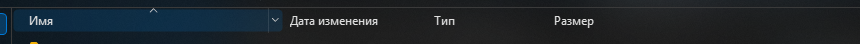
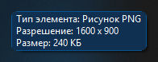

# Explorer Selection Styler

A [Windhawk](https://windhawk.net/) mod that recolors the selection, the hover
highlight, the navigation pane, the column headers and the tooltips of Windows
11 File Explorer.

File Explorer draws the keyboard focus with a thin, opaque grey rectangle and
the hover/selection highlights with flat grey fills. None of that can be
recolored through Windows settings.

This mod replaces those theme parts with its own painting: a translucent fill
and a rounded border of any color for the selected item, a softer fill for the
hovered one, plus matching colors for the navigation pane, the column headers
and the tooltips. Everything is drawn with rounded corners and scales with the
monitor DPI.

## What it changes

- **File list** - selection fill + border, hover fill, no stock grey left behind
- **Navigation pane** - hover and selection of the tree items
- **Column headers** ("Name", "Date modified", ...) - hover and pressed states
- **Tooltips** - background, border and rounded window corners
- **Details pane header** and the other themed item rows are left untouched

## Screenshots


The file list: two selected items with a rounded border, another one hovered.


The navigation pane uses the same palette as the file list.



Hovering a column header paints it with the hover fill instead of the stock
grey rectangle.



Tooltips are recolored and get rounded corners.

## Installation

1. Install [Windhawk](https://windhawk.net/) 1.7 or newer; 2.0 adds the color
   pickers and sliders described below.
2. Open Windhawk, go to **Mods** -> **Create new mod**.
3. Replace the template with the contents of
   [`explorer-selection-border.wh.cpp`](explorer-selection-border.wh.cpp).
4. Press **Compile mod** (Ctrl+B), then **Install mod**.

Alternatively, save the `.wh.cpp` file to disk and use **Install from file** in
the same menu, or install it from a terminal:

```
windhawk-cli.exe mod install --file explorer-selection-border.wh.cpp
```

## Settings

**Windhawk 2.0** draws a real settings form: every color gets a picker with a
swatch, every opacity, thickness and radius gets a slider with a number field.
**Windhawk 1.7.3** shows the same settings as plain text and number fields; the
mod works there too, only without the pickers and sliders.

The settings and the mod name are localized: Windhawk renders them in its own
interface language (English is the default, Russian is included). Switch the
language in Windhawk's settings, the mod follows it.

### Color themes

The first setting is a list of nine themes. Each entry starts with its index and
a color square: `1` blue, `2` violet, `3` teal, `4` green, `5` orange,
`6` crimson, `7` magenta, `8` graphite, `9` custom.

| # | Theme | Accent | Tooltip background |
| --- | --- | --- | --- |
| 1 | Windows blue | `#0078D4` | `#103051` |
| 2 | Violet | `#8B5CF6` | `#241A3D` |
| 3 | Teal | `#2AA198` | `#0E2F2C` |
| 4 | Green | `#37A64B` | `#10331A` |
| 5 | Orange | `#E8862E` | `#3A2410` |
| 6 | Crimson | `#E0455A` | `#3A1219` |
| 7 | Magenta | `#C445B8` | `#3A1436` |
| 8 | Graphite | `#6E7B8B` | `#222932` |
| 9 | Custom | the pickers below | the pickers below |

A theme recolors the border, the fill and the tooltips at once; opacity and
geometry stay as you set them. The color pickers appear only for theme `9`, so
picking a ready palette can't be spoiled by a stray hex value.

### Selection

| Setting | Default | Description |
| --- | --- | --- |
| Border color | `#0078D4` | Color picker, theme `9` only |
| Border opacity | `100` | Slider, `0` (invisible) to `100` (solid) |
| Border thickness | `1` | Slider, 1 to 6 pixels |
| Corner radius | `4` | Slider, `0` for sharp corners |
| Border inset | `1` | Slider, distance between the item edge and the border |

### Fill

| Setting | Default | Description |
| --- | --- | --- |
| Fill color | `#0078D4` | Color picker, theme `9` only |
| Selection fill opacity | `35` | Slider, `0` (transparent) to `100` (solid) |
| Hover fill opacity | `18` | Slider, fill opacity for the item under the pointer |

### Tooltips

| Setting | Default | Description |
| --- | --- | --- |
| Restyle tooltips | `on` | Repaint Explorer tooltips and round their corners |
| Tooltip background color | `#103051` | Color picker, theme `9` only |
| Tooltip border color | `#0078D4` | Color picker, theme `9` only |
| Tooltip corner radius | `6` | Slider, `0` for sharp corners |

The tooltip settings are hidden while the restyling switch is off. Thickness,
radius and inset are in pixels at 100% DPI and are scaled automatically on
monitors with a different scale factor.

## Notes

- Works in File Explorer only (`explorer.exe`). Open/Save dialogs hosted by
  other applications are not affected.
- The mod relies on undocumented theme details (`ItemsView`, `ListView`,
  `TreeView`, `Header` and `Tooltip` parts). A future Windows update could
  change them, in which case the mod simply stops having an effect.
- Toggling the mod or changing a setting takes effect immediately, without
  restarting Explorer.
- The stock drawing is replaced, not hidden: if the mod fails to draw, nothing
  is drawn for that part.

Tested on Windows 11 Pro 26H2 (build 26200) with Windhawk 2.0 alpha 8 and
Windhawk 1.7.3.

## Русский

Мод для [Windhawk](https://windhawk.net/), перекрашивающий выделение и наведение
в Проводнике Windows 11: заливка и скруглённая рамка выбранного элемента,
отдельная заливка для элемента под курсором, та же палитра для панели навигации
и заголовков колонок («Имя», «Дата», «Тип», «Размер»), а также фон, рамка и
скругление всплывающих подсказок.

### Установка

1. Установите Windhawk 1.7 или новее; в 2.0 появляются пикеры цветов и
   ползунки, о которых речь ниже.
2. В Windhawk: **Mods** -> **Create new mod**.
3. Вставьте содержимое файла `explorer-selection-border.wh.cpp` вместо шаблона.
4. **Compile mod** (Ctrl+B), затем **Install mod**.

Можно и просто сохранить `.wh.cpp` на диск и выбрать **Install from file**, или
поставить из терминала:

```
windhawk-cli.exe mod install --file explorer-selection-border.wh.cpp
```

### Настройки

В Windhawk 2.0 настройки выглядят настоящей формой: у каждого цвета — окно
выбора цвета с квадратиком-образцом, у прозрачности, толщины и радиуса —
ползунок с полем числа. В Windhawk 1.7.3 те же настройки показаны обычными
полями, мод работает одинаково.

Названия настроек и мода переведены: Windhawk показывает их на своём языке
интерфейса (по умолчанию английский, русский добавлен). Язык переключается в
настройках самого Windhawk, мод следует за ним.

Сверху список из девяти тем: `1` синяя, `2` фиолетовая, `3` бирюзовая, `4`
зелёная, `5` оранжевая, `6` малиновая, `7` пурпурная, `8` графитовая, `9` —
свои цвета (тогда появляются пикеры). Рядом с номером в списке стоит цветной
квадратик. Тема сразу меняет цвет рамки, заливки и подсказок, а прозрачность и
геометрия остаются вашими.

Далее:

- **Рамка**: цвет, прозрачность, толщина, радиус скругления и отступ от края.
- **Заливка**: цвет, прозрачность выделения и отдельная прозрачность наведения.
- **Подсказки**: включение, цвет фона, цвет рамки и радиус скругления.

Цвета — в формате `#RRGGBB`, прозрачность от `0` (невидимо) до `100` (сплошной
цвет). Толщина, радиус и отступ указаны в пикселях при 100% DPI и
масштабируются вместе с системным.

## License

MIT
